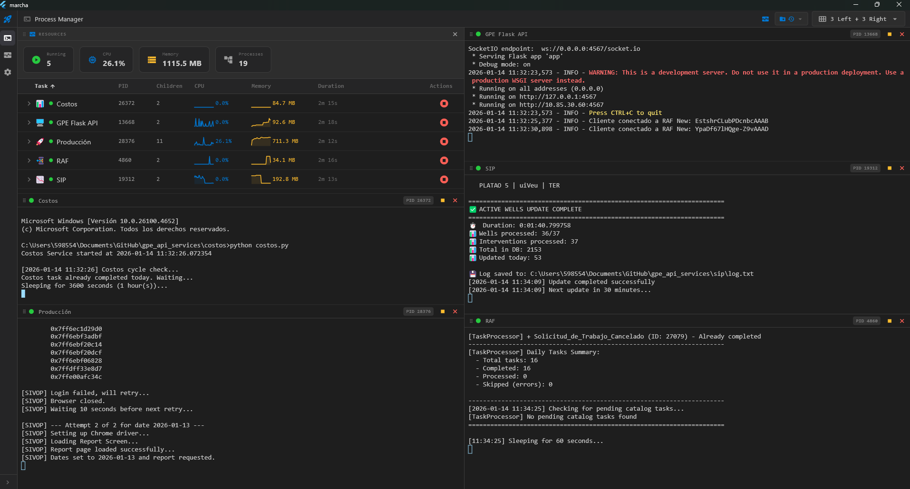

# Marcha

A Windows script and task management application built with Flutter. Marcha provides a flexible multi-pane interface for developers and power users to orchestrate, monitor, and manage multiple processes and terminal instances efficiently.



## Features

### Task Management
- Create, edit, and organize tasks with customizable commands
- Group tasks for batch execution
- Task properties: name, executable, arguments, working directory, emoji icons, descriptions
- Placeholder support (`{{placeholderName}}`) for parameterized execution

### Automation Steps
Define automated interaction sequences for your tasks:
- Each step waits for a regex pattern in terminal output, then optionally sends a command
- Configurable timeout per step (default 30 seconds)
- Retry or skip on timeout
- Terminal becomes fully interactive after steps complete

### Multi-Terminal Dashboard
- Run multiple terminal instances simultaneously
- Full xterm emulation with PTY support (10,000-line history)
- ANSI color and escape sequence support

### Flexible Layouts
10 preset layouts to organize your workspace:
- Single pane, 2/3 columns, 2/3 rows
- Split layouts (2+1 configurations)
- 2x2 Grid

**Resizable Panes**: Drag dividers between panes to customize sizes. Ratios are saved per layout.

### Process Control
- Graceful shutdown with Ctrl+C, fallback to force kill
- Complete execution history with timestamps and exit codes
- Terminal output logging

### Theming & Customization
- Dark/Light mode
- Custom terminal color themes
- Text size presets (S/M/L/XL)

### Scheduled Jobs
- Run a command every day at a time, or every N minutes, with no terminal open (**Scheduled** in the left bar)
- One catch-up run after the PC was off or Marcha was closed, however many times were missed
- Every run is recorded with its trigger, exit code and output
- Settings > Startup > **Start Marcha with Windows** brings the clock back after a reboot

### Local API
- An HTTP API on `127.0.0.1` so scripts and assistants on the same PC can list, start, stop, restart and read tasks and scheduled jobs
- Off by default; see [Local API](#local-api) below before turning it on

### Coming Soon
- **Resources Monitor** - CPU and memory monitoring
- **Project Config Files** - Load `marcha.config.json` from your projects for parameterized scripts

## Installation

### Download

A built copy for Windows is on the [releases page](https://github.com/0xjmsl/marcha/releases): unzip it and run `marcha\marcha.exe`. There is no installer. Windows SmartScreen asks once because the build is not code-signed.

### Prerequisites
- Flutter SDK (3.0+)
- Visual Studio with C++ build tools (for Windows)
- Windows 11 SDK

### Build from Source
```bash
# Clone the repository
git clone https://github.com/0xjmsl/marcha.git
cd marcha

# Get dependencies
flutter pub get

# Run in debug mode
flutter run -d windows

# Build release
flutter build windows --release
```

## Usage

### Creating Tasks
1. Click **Add Task** in the sidebar
2. Enter task name, executable (e.g., `python`, `npm`, `code`)
3. Add arguments and working directory
4. Choose an emoji icon
5. Optionally add automation steps (expand the Steps section)
6. Save and launch with the play button

### Using Automation Steps
1. Edit a task and expand the **Steps** section
2. Add steps with:
   - **Expect**: regex pattern to wait for in output
   - **Send**: command to send when pattern matches
3. Steps execute in order when the task starts
4. If a step times out, you can retry or skip it
5. After all steps complete, the terminal is fully interactive

### Layout Management
- Use the layout selector in the header to switch between 10 presets
- Drag the dividers between panes to resize them
- Your size preferences are saved per layout

## Local API

Marcha can serve an HTTP API on this PC only (`127.0.0.1`, port 7832 by default): **API** in the left bar, the switch under Server. The **Endpoints** list on that screen shows every call and lets you switch each one off.

What it can do is what you can do in the window: start saved tasks, type into a running terminal, kill and restart tasks, and create scheduled jobs that run any command. Treat it accordingly.

### Security: use signed requests

**We recommend turning on signed requests whenever the API is on.** Add at least one address under **Allowed Addresses** on the API screen. From then on Marcha answers only requests signed by one of those keys; everything else gets `401`.

- Without an allowed address the API has no authentication: any program on the PC can use it.
- Requests that come from a web page are always refused (an `Origin` header, a browser preflight, or a `Host` that is not Marcha's own loopback address), signed or not, and no CORS header is sent. Builds before 1.0.1 did not refuse them: update if you use the API.
- Switch off the endpoints you do not use.

**The signed request.** An Ethereum-style key signs (EIP-191, `personal_sign`) the compact JSON of these six fields, in this order:

```json
{"action":"get_tasks","client":"0xabc...","data":{},"nonce":"9f2c...32 hex","path":"/api/tasks","timestamp":1795000000}
```

and sends this envelope: as the `X-Signed-Request` header on a GET, as the body on a POST (`data` is the call's payload):

```json
{"timestamp":1795000000,"action":"get_tasks","path":"/api/tasks","nonce":"9f2c...","data":{},"client":"0xabc...","signature":"0x..."}
```

Marcha recovers the signer and checks that:

- it is one of the allowed addresses;
- `action` is the action of the endpoint being called (the Endpoints list shows each one) and `path` is the path being called, so a signature for one call is good for no other;
- `nonce` (16 characters or more, random) was never used by that signer;
- `timestamp` (Unix seconds) is within the tolerance set on the API screen, 5 minutes by default.

The key is yours to make and keep: any secp256k1 key works, and it does not need to hold or be anything on any chain. `test/signed_request_test.dart` has envelopes signed by a Python client (`eth_account`) to check an implementation against.

## Data Storage

All user data is stored locally in `%APPDATA%\Marcha\` (typically `C:\Users\<YourUsername>\AppData\Roaming\Marcha\`):

| File                       | Description                                       |
| -------------------------- | ------------------------------------------------- |
| `marcha_settings.json`     | Application settings (theme, layout, pane ratios) |
| `templates.json`           | Your task/template definitions                    |
| `task_groups.json`         | Task group configurations                         |
| `display_order.json`       | Sidebar ordering                                  |
| `marcha_task_history.json` | Execution history                                 |
| `logs/`                    | Process output logs                               |

**Privacy Note**: Your tasks and configurations are stored only on your local machine. The repository does not include any user data, so you can safely share or publish your fork without exposing personal task configurations.

## Tech Stack

- **Framework**: Flutter (Dart)
- **Terminal**: xterm.dart + flutter_pty
- **Platform**: Windows 11

## Documentation

See the [docs](./docs/) folder for additional documentation.

## License

MIT License - See LICENSE file for details.


